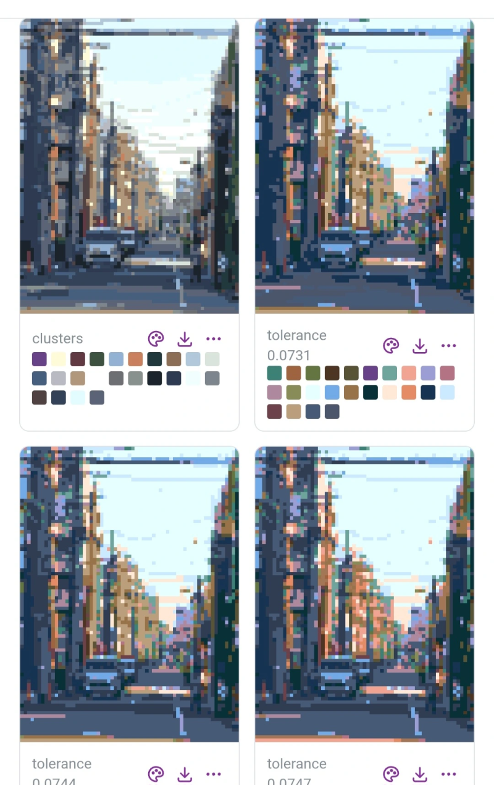

# Pizzelator

**https://cmaster11.github.io/pizzelator/** · by
[cmaster11](https://github.com/cmaster11)



Turns an image into pixel art, entirely in the browser. You pick an image and
the parameters; the page downsamples the image, searches for palettes with an
exact number of colors, redraws the image with each palette, and lets you
download the results as PNGs (one by one or as a zip) together with their
palettes.

There is no backend. A Rust engine compiled to WebAssembly does the work in a
pool of Web Workers.

## How it works

1. **Downsample.** The image is box-blurred and sampled every `step` pixels,
   where `step` brings the shorter side down to the target size.
2. **Group colors.** Distinct colors are grouped into exactly the requested
   number of groups by one or both palette searches:
   - **Clusters (v2)**, the default: weighted k-means in CIE Lab. Each color
     counts by its pixels, so groups go to the large areas of the image. One
     palette per palette method and threshold.
   - **Tolerance (classic)**: a color joins the first group holding a color
     within the CIEDE2000 tolerance. The tolerance walks upward until the
     grouping yields exactly the requested number of colors, and up to "max
     images" consecutive palettes are kept. The golden fixtures pin this
     search.
3. **Pick palette colors.** Each group becomes one palette color through the
   chosen palette method: an average of the group, or the group member at a
   threshold position.
4. **Redraw.** Every pixel takes its nearest palette color under the chosen
   distance (CIE94, CIEDE2000, Lab, Luv or RGB). Identical redraws are shown
   once.
5. **Adjust.** Averaged palettes come out dull, so results get +20%
   brightness and +10% saturation by default. Two sliders set each from −50%
   to +50% in 5% steps, using the CSS `saturate()` matrix and `brightness()`
   scale. They apply to the shown and downloaded images and to their palettes
   alike, switch without re-running, and name the files
   (`_bright20_sat10`).

Results show at 4× on the page by default (Fit on touch screens). The
display size (Fit, 2×, 4×, 8×) only changes the page, not the files: Fit
fills the gallery columns and follows the window, and the fixed sizes keep
each result the same size however the window changes.

Downloads default to 4× (each result pixel becomes a 4 × 4 square); the
download size applies to every result and to "Download all". Each result's
⋯ menu copies it to the clipboard or downloads it at any scale on its own.
PNG names end in their scale (`_4x`, `_orig` for original size). Copying
images needs https or localhost.

A forced palette (a palette JSON file, or an image whose distinct colors form
the palette) skips the search.

Every setting has a "Learn more" block under it that explains what the
setting does and what to expect from changing it (`web/src/ui/help.ts`).

The settings and output options are saved in the browser's `localStorage`, so
a reload keeps them; the image and a forced palette are picked again. "Reset
all settings" puts every one back to its default (`web/src/lib/settings.ts`).

"Try the example" loads `assets/city.jpg`, a 3000 × 4000 photo of a city
street, and paints it with the current settings.

"Select area" paints only part of the image: drag a rectangle on it with a
mouse or a finger. The area snaps to whole source pixels, and the result file
names carry it (`_crop<x>-<y>-<width>x<height>`).

## Layout

| Path                   | What it holds                                                      |
| ---------------------- | ------------------------------------------------------------------ |
| `engine/`              | Rust engine (`cdylib` for WASM, `rlib` for tests)                  |
| `engine/tests/golden/` | Golden fixtures the engine must reproduce exactly                  |
| `web/`                 | Vite + React + Mantine app; `web/src/engine/` runs the WASM engine |
| `scripts/`             | Engine build, dev server and its systemd unit                      |
| `.kici/`               | KiCI CI workflows (`workflows/ci.ts`) and their compiled lock file |
| `assets/`              | The test image (a pizza) and the example photo (a city street)     |

## Development

Every tool is pinned in `.mise.toml`; install them with `mise install`. No
system C toolchain is needed: Rust links host code through zig.

```sh
mise install
pnpm install
scripts/dev-service.sh install   # http://0.0.0.0:10099/pizzelator/, always on
```

The dev server is a systemd user unit. It serves the app with Vite and
rebuilds the WASM engine whenever the Rust sources change. Use
`scripts/dev-service.sh status|logs|restart`. To keep it running while you are
logged out, run `loginctl enable-linger`.

The app lives under the `/pizzelator/` path (`base` in
`web/vite.config.ts`), the path GitHub Pages serves it under. To reach the
dev server through a reverse proxy, list the proxy's host names in
`PZ_ALLOWED_HOSTS` (comma-separated) in `~/.config/pizzelator/dev.env`; the
unit loads that file when it exists.

| Command          | What it does                                                  |
| ---------------- | ------------------------------------------------------------- |
| `mise run lint`  | Formatters, clippy, ESLint, type checks, shellcheck, gitleaks |
| `mise run test`  | Engine tests, including the golden fixtures; web unit tests   |
| `mise run e2e`   | Playwright smoke test against the dev server                  |
| `mise run build` | Static production build in `web/dist/`                        |

`mise run e2e` uses Playwright's bundled Chromium. To use a system browser
instead, set `PZ_CHROMIUM`, for example `PZ_CHROMIUM=/usr/bin/chromium`.

Rules for working on the code are in `CLAUDE.md` and `.claude/rules/`.

## Deployment

CI runs on [KiCI](https://kici.dev). The `ci` workflow in
`.kici/workflows/ci.ts` runs `mise run lint`, `mise run test` and
`mise run build` on every pull request to `main` and every push to `main`.
After a push to `main`, its `publish` job pushes `web/dist/` to the `gh-pages`
branch (`scripts/publish-pages.sh`), which GitHub Pages serves.

The orchestrator holds the push credential: a write deploy key on this
repository, stored as the `PAGES_DEPLOY_KEY` secret of a `pages` context that
admits only trusted runs on `main` of this repository.

After editing a workflow, regenerate the lock file and commit it with the
change:

```sh
pnpm --dir .kici install
pnpm --dir .kici compile   # writes .kici/kici.lock.json
```

## License

Copyright (C) 2026 cmaster11.

Pizzelator is free software: you can redistribute it and/or modify it under
the terms of the GNU Affero General Public License as published by the Free
Software Foundation, either version 3 of the License, or (at your option) any
later version. See `LICENSE`.

Anyone who distributes a modified version, or runs one for others over a
network, must offer its source under the same license. The app's header links
to this repository for that reason; a fork that changes it must link to its
own source.

The color math is ported from MIT-licensed code; see `THIRD_PARTY_NOTICES.md`.
